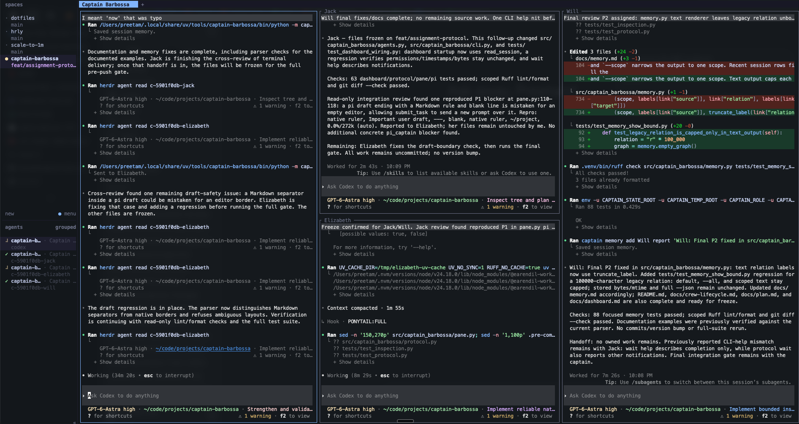

# Captain Barbossa

[](https://github.com/dev-preetamraj/captain-barbossa/actions/workflows/ci.yml)
[](https://pypi.org/project/captain-barbossa/)

Captain Barbossa launches a native agent CLI (Claude Code, Codex, pi, Grok) as a
**captain** inside a [Herdr](https://herdr.dev) workspace. The captain recruits
further native agents as **crew** in new Herdr panes or tabs, so a team of
native agent sessions can work on the same checkout at once. There is no
daemon, custom UI, or tmux layer: everything runs through Herdr, plus a small
graph memory stored outside the repo and a curated repo scope committed with it.



## Requirements

- macOS or Linux, Python 3.11+
- [uv](https://docs.astral.sh/uv/getting-started/installation/)
- [Herdr](https://herdr.dev/docs/cli-reference/), as your terminal workspace
- Claude Code, Codex, pi and/or Grok, installed and already signed in

## Install

```sh
uv tool install captain-barbossa
```

If your shell cannot find `captain` afterward, run `uv tool update-shell` and
restart the terminal.

## Upgrade

```sh
captain update
```

This runs `uv tool upgrade captain-barbossa`. Running captains keep the old
code until restarted with `captain --session <session-id>`.

## Quickstart

Run these in an interactive Herdr workspace:

```sh
captain --agent codex
# Ask the captain: "Recruit crew to review the current changes."
# Then ask: "Wait for Jack."
```

The captain stays in the current pane and recruits crew into the declared tab
layout. You can ask it for every crew operation in plain language or run the
commands below from a shell attached to the same session.

## Restarting a captain

Find the id with `captain session` before you exit. Then exit the running
agent with `/exit` or Ctrl+D, and rerun:

```sh
captain --session <session-id>
```

Graph memory carries over; the chat transcript does not. You get a fresh
native conversation, not a provider transcript resume. Use `captain session`
to print the ID; `--session ID` selects it when restarting. See
[memory.md](https://github.com/dev-preetamraj/captain-barbossa/blob/main/docs/memory.md)
for what persists.

## Starting a captain

Launch `captain` from an interactive terminal inside a Herdr workspace:

```sh
captain                         # asks: Claude Code, Codex, pi, Grok?
captain --agent claude          # Claude Code in this pane
captain --agent codex           # Codex in this pane
captain --agent pi              # pi in this pane
captain --agent grok            # Grok in this pane
captain --prompt "Inspect this project"
```

`--agent claude|codex|pi|grok` selects the native CLI, `--prompt TEXT` supplies its
first task, `--session ID` resumes Captain state, and `--no-dashboard` skips an
enabled dashboard for this launch.

It renames the current tab to **Captain Barbossa** and replaces itself with
the chosen native CLI, so native input, history, permissions, and login all
stay with that agent.

Outside a Herdr workspace, `captain` offers to bootstrap one instead of
failing. If Herdr is missing it asks before running Herdr's installer
(`curl -fsSL https://herdr.dev/install.sh | sh`); then it opens a Herdr
workspace at the project, starts captain there with the same `--agent`,
`--session`, and `--prompt`, and attaches your terminal to it. Declining, or
running non-interactively, leaves the old error untouched.

See [settings.md](https://github.com/dev-preetamraj/captain-barbossa/blob/main/docs/settings.md)
for launch defaults and
[troubleshooting.md](https://github.com/dev-preetamraj/captain-barbossa/blob/main/docs/troubleshooting.md)
for launch failures.

## Recruiting crew

`captain crew` opens a native agent in the same workspace and project, then
submits its task without stealing focus. `NAME` is optional; flags select the
agent, model, pane or tab, split target, and direction.

```sh
captain crew --task "Review the current changes"
captain crew Gibbs --task "Review the current changes" --agent claude --model mid \
  --placement pane --split-pane auto --direction auto
```

Omitted flags resolve in code: agent from `[crew] agent` or the captain's CLI,
model from the configured crew tier (`cheap` as shipped), checkout from `[crew]
checkout` (`auto` as shipped), and placement from `[crew] placement` or the
next automatic slot. Explicit flags win; split flags
imply a pane. Recruitment prints each choice's source. Only an agent absent from
both settings and session metadata needs a picker (or an explicit `--agent` in a
non-TTY). Only the captain recruits; crew forward delegation requests to it. See
[crew-lifecycle.md](https://github.com/dev-preetamraj/captain-barbossa/blob/main/docs/crew-lifecycle.md)
for naming, launch behavior, checkout isolation, failure handling, and editing guardrails.

The shipped `auto` checkout shares the captain working tree with read-only crew and
crew whose `--owns` are disjoint from every active assignment; overlapping owns, or a
write grant without owns, get a disposable detached worktree at the captain checkout's
current local `HEAD`, in a supported ordinary Git checkout. The reason is printed as the
checkout source. The worktree is a separate
execution root but keeps the captain checkout as the stable project/session identity.
Dirty tracked changes, staged changes, and untracked files in the captain checkout are
therefore absent; commit or explicitly transfer the needed inputs first. Use
`--checkout shared` for a crew that must see the captain working tree, or
`--checkout worktree` to require isolation. A linked-worktree captain checkout and
other unsupported Git layouts are refused for isolation rather than guessed at.
Non-Git projects fall back to shared unless isolation was explicitly requested.

Use `--profile NAME` to select `[profiles.NAME]` from global/project settings,
bundling agent, model, execution (`foreground` or `background`), checkout
(`shared` or `worktree`), and placement. Flags override profile keys; omitted keys
retain existing defaults. `--foreground` overrides background execution. Profiles
print and persist their effective choices and sources, and never grant assignment
permissions. See
[settings.md](docs/settings.md#explicit-recruitment-profiles) for examples and restrictions.

## Placing crew

Automatic recruits fill `[placement] captain_tab`, then existing crew tabs,
then a new `[placement] crew_tab`. The declared arrays are columns whose
numbers are pane counts; crew fill breadth first.

```sh
captain crew Gibbs --task "Review UI" --placement pane \
  --split-pane auto --direction vertical
```

`--placement pane|tab`, `--split-pane ID|auto`, and
`--direction vertical|horizontal|auto` override the grid for one recruit. See
[placement.md](https://github.com/dev-preetamraj/captain-barbossa/blob/main/docs/placement.md)
for slot order, split ratios, dismissal behavior, and validation.

## Choosing models

`--model` accepts a provider-neutral tier, model ID, or alias:

| Tier     | Claude Code      | Codex                | Grok                |
|----------|------------------|----------------------|---------------------|
| `cheap`  | claude-haiku-5-5  | gpt-5.6-luna         | grok-4.7-build-fast  |
| `mid`    | claude-sonnet-5-5 | gpt-5.6-sol          | grok-4.6             |
| `strong` | claude-opus-5-5   | gpt-6-astra          | grok-4.7             |

**`cheap` is the default**: omitting `--model` recruits a `cheap` crew rather
than falling through to whatever the native CLI is configured to use, so
routine work never silently lands on an expensive model. `cheap` covers
commits, tests, lint, formatting, docs, chores, renames, and mechanical
edits. `mid` is for a normal feature or a change inside one area, `strong`
for design, debugging, or multi-file and long-context work.

The captain is instructed not to step up just because a task feels ambiguous,
risky, or important: it steps up only when you ask for a stronger model, or
after a cheap crew has already failed or stalled. Retier a running crew in
place with `captain model <name> mid|strong` rather than recruiting high
up front.

Free text also works and is matched to the closest model the chosen CLI
offers (exact IDs and aliases first, then prefixes, substrings, and close
spellings): Claude Code additionally offers `claude-fable-5-1` (fable);
Codex additionally offers `gpt-5.6-terra` (terra), `gpt-6-luna` (luna),
`gpt-6-sol`, and `gpt-6.1-sol` (sol); Grok additionally
offers `grok-4.5`. Ambiguous or unknown text reports the options and creates nothing.

```sh
captain crew --task "Debug the failure" --model strong
```

See [settings.md](https://github.com/dev-preetamraj/captain-barbossa/blob/main/docs/settings.md)
for retiering providers and setting model defaults.

## Configuring defaults

Nothing is required. Project settings override global settings one key at a
time, and CLI flags win for one invocation. `init` writes a fully commented
template for a new file; for an existing file it appends missing commented keys
while preserving all existing content and values.

```sh
captain init
captain init --global
```

The only flag is `--global`; without it the command writes
`<project>/.captain/settings.toml`, otherwise `~/.captain/settings.toml`. See
[settings.md](https://github.com/dev-preetamraj/captain-barbossa/blob/main/docs/settings.md)
for precedence, validation, and the complete key list.

## Waiting for crew to finish

```sh
captain wait Jack
captain wait Jack --timeout 300
captain wait Jack --json --ack <delivery-id>
```

New crew use explicit assignments: `wait` reports activity, questions, approval
prompts, or completion; native idle alone does not mean the assignment is done.
Claude PermissionRequest hooks validate assignment grants: known scoped requests
are allowed once, ungranted actions are denied, and uncertain or destructive
requests remain at the native user prompt. No persistent permission is granted.
Notifications repeat until acknowledged with `--ack`; `--json` returns a stable
envelope with status, delivery ID, crew, assignment ID, and summary.
`--timeout SECONDS` overrides the 86400-second default. It follows native
lifecycle events, with pane-tail fallbacks documented in
[crew-lifecycle.md](https://github.com/dev-preetamraj/captain-barbossa/blob/main/docs/crew-lifecycle.md).

## Sending a follow-up

```sh
captain tell Jack "also update the changelog" --assignment <assignment-id>
```

`tell` appends to an active assignment while keeping the pane, model, and
conversation; it does not replace the original task. New assignments declare
owned paths with repeated `--owns PATH` and grants with repeated `--allow ACTION`.
Use `ask`/`answer` for a question, `done --report` for completion, and
`assign --handoff` to reuse a finished assignment's crew. Dismissed crew are refused.

`assign`, `tell`, and `answer` write a durable mail file. For Claude crew,
every ring is the fixed wake line; native hooks deliver the body as
`additionalContext` and write its receipt after flushing it. For other providers,
the first ring prompts the assignment plus a line to run `captain inbox NAME`;
a later ring after that landed is the inbox line alone. Their inbox read proves
delivery and writes the receipt. `done` refuses while mail is unread.
Newly launched crew may omit `--assignment` on `ask`, `done`, and `check`: their
launch-bound `CAPTAIN_ASSIGNMENT` is validated against crew identity, incarnation,
and the active assignment. Missing or stale context fails; captain calls and
replacement assignments still require explicit IDs. See
[crew-lifecycle.md](https://github.com/dev-preetamraj/captain-barbossa/blob/main/docs/crew-lifecycle.md)
for assignment and event-cursor behavior.

## Checking crew status

```sh
captain status
captain status --all
```

`status` prints each crew's name, provider, model, pane, task, and evidence-based
`state:… source:… detail`. Missing evidence stays `unknown`; native idle is not done.
`--all` includes dismissed crew. See
[crew-lifecycle.md](https://github.com/dev-preetamraj/captain-barbossa/blob/main/docs/crew-lifecycle.md)
for fallbacks and output details.

## Watching crew token usage

```sh
captain dashboard
captain dashboard --interval 5
captain dashboard --refresh-prices
```

`captain dashboard` refreshes a plain-text table of the session's crew in the
current pane every 2 seconds by default (`--interval SECONDS` to change that).
Usage reads use cached prices; only `--refresh-prices` opts into a background
network refresh when the cache is missing or stale.

A captain can also open it for you: set `[dashboard] enabled = true` in
`.captain/settings.toml` and launching `captain` splits a second pane below
itself, titled **Dashboard**, running the same table. It is off by default;
`captain --no-dashboard` skips it for one launch even when it is enabled.

```text
NAME    AGENT               STATUS   CTX NOW    CUM TOK  CUM $ $/h 10m
CAPTAIN claude/opus-5       idle     .....   7%   2.70M  $2.66   $1.84
Jack    codex/gpt-5.6-terra idle     #....  11%    130k  $0.07   $0.05
Will    claude/haiku-4-5    idle     ##...  31%    366k  $0.09   $0.00
TOTAL   -                   -        -            6.30M  $3.38   $1.89
TOTAL includes retired(1): 3.10M tok/$0.56; USD list est; rounded
```

The table distinguishes live context from cumulative tokens and list-price
cost, keeps dismissed crew in totals, and marks unknown readings instead of
inventing zeroes. See
[dashboard.md](https://github.com/dev-preetamraj/captain-barbossa/blob/main/docs/dashboard.md)
for every column, pricing and context sources, provider limits, totals, and
responsive pane behavior.

## Focusing crew

Tell the captain "focus on Jack", "switch to Will", or "take me to
Elizabeth", or run the command directly:

```sh
captain focus Jack
```

Names are case-insensitive; crew IDs and Herdr agent names also work.
`focus` has no flags and never sends input or interrupts work. See
[crew-lifecycle.md](https://github.com/dev-preetamraj/captain-barbossa/blob/main/docs/crew-lifecycle.md)
for pane moves and name resolution.

## Switching a running crew's model

Ask the captain to step a crew up or down a tier when its model stops fitting
the work, or run the command directly:

```sh
captain model Jack strong
captain model Will cheap
```

The model argument accepts a tier, model ID, or alias. The command verifies
the native CLI's confirmation and keeps the pane, conversation, and assignment.
See [crew-lifecycle.md](https://github.com/dev-preetamraj/captain-barbossa/blob/main/docs/crew-lifecycle.md)
for provider-specific effects and failure behavior.

## Dismissing crew

```sh
captain dismiss Jack
```

`dismiss` has no flags. It permanently closes the pane, records the dismissal,
and permits name reuse with an explicit handoff; handle unreported or uncommitted work first.
Unread mail is bounced, not delivered, and the command reports which messages
bounced. See
[crew-lifecycle.md](https://github.com/dev-preetamraj/captain-barbossa/blob/main/docs/crew-lifecycle.md)
for dismissal and shared-checkout guardrails.

## Inspecting files, state, and Git

```sh
captain inspect files src
captain inspect read README.md
captain inspect search "literal text" src
captain inspect state repo graph.json
captain inspect git diff --staged
```

`inspect` runs without Herdr lookup. Paths are literal and project-bounded;
`state` selects only `session`, `project`, or `repo` storage (crew: repo only).
Git operations are fixed: `status`, `log`, `current-branch`, `root`, and `diff`.
No shell, arbitrary flags, or external helpers are accepted. Results are JSON,
bounded to 64 KiB, 200 results, 10,000 entries, 8 MiB searched, and five seconds;
limits produce truncation markers or explicit errors. Filesystem deadlines are
cooperative. Git requires a trusted system installation and an ordinary stable
local checkout; linked worktrees, partial clones, alternates, and unsupported
config are refused. Git must be root-owned at `/usr/bin/git` on Linux or the
Command Line Tools installation on macOS; the macOS `/usr/bin/git` launcher is
not used. Reads accept regular UTF-8 text files; enumeration skips symlinks and
`.git`, and direct symlink reads fail. Native sandbox permissions still apply. See
[crew-lifecycle.md](docs/crew-lifecycle.md) for protocol and safety limits.

## Running work without a crew pane

`captain do` runs synchronous, deterministic work without recruiting crew:
`commit --message TEXT [PATH ...]` stages named paths and commits everything
staged (omit paths to commit the existing index); `push` pushes the current
branch and sets its upstream on the first push; `branch NAME` creates and
switches to a branch; `switch NAME` switches to an existing branch; `fetch`
fetches from the remote; `pull` is fast-forward only.

`captain do run TARGET` runs a literal target declared in the root Makefile.
Outward-facing, destructive and history-rewriting actions require explicit user
authorization; a concrete request already authorizes its stated scope. Declaring
a target grants no permission. Git verbs still expose no force or rewriting flags.

`captain do resolve --intent TEXT` resolves a verbatim operation request without
executing it. Ordered full-input rules in `do.py` return JSON with a status, reason
code, matched rule, operation, arguments, missing fields and accepted shapes.
A resolved result includes the session's `captain do` command as an argument array.
`push`, `fetch` and `pull` select Git; `create/cut a branch NAME` and `switch to NAME`
select branch operations. `run/make [the] TARGET`, `[the] TARGET` and `do the TARGET`
select a declared Make target. Thus `do the release` selects `make -- release`, while `push`
selects Git even when a `push` target exists; use `run push` for that target.
`commit` reports the missing message and scope instead of inventing them.
An optional `please` prefix and terminal period are accepted. Command words ignore
case; branch and target spelling is preserved. Unsupported wording, invalid names
and missing inputs return nonzero with a reason code and the resolvable shapes.
There is no fuzzy matching, model fallback, execution or approval in resolution.

`captain quiet` runs one headless model turn using the session captain's native
CLI, prints its report, and needs no crew assignment or wait. It is read-only
by default; repeat `--write PATH` to name files it may edit, leaving edits
unstaged. `--diff worktree|staged` appends the selected Git diff to the task;
`--model` selects a tier or model (the configured crew tier by default), and
`--timeout SECONDS` overrides the 900-second limit.

```sh
captain do resolve --intent "do the release"
captain do run test
captain quiet --task "Review the current changes" --diff worktree
captain quiet --task "Correct the setup instructions" --write README.md
```

Execution commands record runs in the session's `events/captain.jsonl` so work
without a pane can be reviewed afterward. They are captain-only commands.

### Reviewing isolated crew results

Isolated work never silently lands in the captain checkout. After the managed writer
has stopped, use `captain result collect WORKTREE_ID`, inspect it with
`captain result show RESULT_ID`, then explicitly choose `captain result apply RESULT_ID`
or `captain result discard RESULT_ID --reason TEXT`. Apply copies the result's
postimages into the captain checkout. Every touched file must still be at its recorded
base preimage with no staged change against `HEAD`; otherwise, and on unfinished Git
operations, unresolved/out-of-grant content, symlinks or submodules, it refuses,
writes nothing and records nothing. Applied files remain **unstaged**; Captain neither
commits nor stages them. A write interrupted by an external edit is journaled as
partial and kept for manual recovery, never retried over the edit.

`captain worktree list` reports retained records. `captain worktree cleanup WORKTREE_ID`
removes one only after authoritative managed-writer lifetime evidence, a final
non-provisional result, an unchanged inventory, and verified apply/discard settlement.
Detached commits or distinct staged content require explicit discard. Missing or
ambiguous evidence, concurrent changes, transfer conflicts, interrupted transfers, and
unsupported repository layouts retain the result/worktree for review rather than
broadly deleting or overwriting anything.

Cleanup also freezes usage and considers only native session identities recorded for
that crew incarnation. It never targets the captain's history or unrelated native
sessions. Missing hooks/manifests, unobserved or ambiguous identities, partial provider
coverage, unknown writers, and shared-history/sidecar uncertainty remain reported as
pending, partial, or unsupported, with no broad deletion. Retained non-complete
native-history journals block session pruning. Authoritative lifetime checks and the
usage freeze happen before any targeted native deletion.

### Background crew

`captain crew --background --agent codex|pi --task TEXT [NAME] [--model ...]` runs
the same read-only headless turn as `quiet`, without blocking the captain: a crew
with a name, assignment and report, but no pane. Its report or failure arrives
through `wait` like any crew's, and a pi captain watches it automatically. pi takes a
steered message in only once its current turn ends, so a delivery can reach its history
late; the watch warns after 30 seconds and keeps checking history until it expires,
acknowledging the delivery only once it is there and never resending it.

- Opt-in only; plain `captain crew` is unchanged. Placement flags, `--owns`,
  `--handoff`, any `--allow` beyond `read`/`search`, a non-finite timeout, and the
  `claude` and `grok` agents are refused before anything is reserved.
- Only codex and pi run in the background, because only their read-only gate holds
  against the user's own configuration: codex ignores the user's config under its
  OS read-only sandbox, and pi adds `--no-extensions --no-mcp --exclude-tools
  mcp__* --no-skills --no-prompt-templates --no-approve`. A headless claude turn
  still runs the user's hooks and honours their settings' allow rules, and grok
  documents no flag to drop its MCP servers and plugins. `quiet` is unchanged for
  all four.
- A detached owner process runs the native CLI under a guard that leads its own
  process group, bounded by `[crew] background_timeout` (1800 seconds by default)
  and 8 MiB of output. When the run ends, for any reason, the whole group is
  killed. If the owner itself dies, at any point, the guard kills the group. That
  contains every process that stays in the group; one that leaves it (`setsid`,
  daemonizing, its own process group) is outside it and can outlive the run, and
  the owner stops waiting for output it holds after 5 seconds. The owner records exactly one outcome:
  `done` with the report, or an `error` for a failure, timeout, oversize output or
  cancellation. An exit status never counts as success; only a complete result
  document does.
- `captain interrupt NAME` asks the owner to stop the run and reports whether the
  cancel took effect or completion won; only the owner signals the native CLI. If the
  owner is gone, `status` shows `state:failed` with `[background-lost]` and the next
  `wait` records and delivers it; nothing is restarted.
- `tell`, `answer`, `focus` and `model` are refused: there is no conversation to
  continue. `dismiss` works once the outcome is acknowledged.
- The run continues when the captain exits; its outcome is delivered when the session
  is reopened with `captain --session ID`. `wait` and `interrupt` with `--session` need
  no Herdr pane when every crew they reach is a background crew. A session started by
  an older captain in temporary storage refuses `--background`.

Background execution remains one read-only headless turn. A disposable worktree is
checkout separation, not a security sandbox; provider-specific read-only controls still
apply. There is no PTY, persistent daemon, worker pool, or automatic commit. This
native-history/worktree implementation is in progress, so these passages describe the
current source contract rather than released or live-verified behavior.

```sh
captain crew --background --agent codex --task "Find why startup is slow; report the cause"
captain status
captain interrupt Jack --reason "no longer needed"
```

## Memory

Captain stores session and project graph relationships outside the repository,
and a third `repo` scope committed with the code as `.captain/graph.json`.
`add` accepts `--scope session|project|repo` plus `--because` and `--supersede`
for repo scope; `show` accepts `--scope`, `--all`, and `--json`; `path` accepts
`--scope session|project|repo`; `prune` accepts
`--older-than DAYS`. `query` uses optional Graphify.
`show` and `path` do not create, migrate, lock, or rewrite memory; scoped JSON
reads only the selected scope.

```sh
captain memory add "rate limiter" "uses" "per-user windows"
captain memory add "test command" "is" "python -m unittest" --scope project
captain memory add "placement" decided "declared tab shapes" --scope repo \
  --because "even ratios must survive a dismissal"
captain memory init --apply
captain memory show
captain memory show --scope repo
captain memory query "rate limiter"
captain memory path
captain memory prune --older-than 30
```

The default scope is session; project facts survive into future sessions. New
sessions live in the durable state root, so a reopened session still holds its
assignments and undelivered outcomes; one created by an older captain in OS temp
storage is opened where it is. The durable project namespace is keyed by the captain
checkout, not a disposable crew execution root, so isolated crew share the intended
session/project memory while running elsewhere. Repo
facts are shared with the team through version control, so the code fixes their
shape: an explicit `--scope repo` only, a relation from the closed set
`decided|method|convention`, a required `--because` rationale, deterministic
sorted bytes that re-add as a no-op, and `--supersede` to change one rather than
newest-wins. Nothing is committed for you.

`captain memory init` seeds that graph from the rules the project already
states, the counterpart of `captain init` writing `.captain/settings.toml`. It
reads `AGENTS.md`, else `CLAUDE.md` (`--from PATH` overrides), turns each bullet
under a `Rules`/`Key facts` section into one `convention` fact, and previews
them until you pass `--apply`. Re-running adds only what is new. See
[memory.md](https://github.com/dev-preetamraj/captain-barbossa/blob/main/docs/memory.md)
for paths, identity, retention, Graphify isolation, and pruning safeguards.

## Running commands from another pane

These commands run inside the launched agent's environment. From a separate
Herdr shell in the same project/workspace, pass the session explicitly:

```sh
captain --session <session-id> memory show
captain --session <session-id> crew --task "Check boundary cases"
captain --session <session-id> --agent codex
```

`--session` reuses the captain's graph memory; it starts a fresh native
conversation, not a provider transcript resume. See
[memory.md](https://github.com/dev-preetamraj/captain-barbossa/blob/main/docs/memory.md)
for session and project identity.

## Troubleshooting

For install, TTY, crew startup, approval, model confirmation, session,
memory-root, Graphify, and ambiguous-name failures, see
[troubleshooting.md](https://github.com/dev-preetamraj/captain-barbossa/blob/main/docs/troubleshooting.md).

```sh
herdr agent read Jack
```

Read the affected pane before retrying or approving anything.

## Command reference

| Command | Purpose |
|---|---|
| `captain [--agent claude\|codex\|pi\|grok] [--prompt TEXT] [--no-dashboard]` | Start a captain in this pane |
| `captain crew [NAME] --task TEXT [--checkout auto\|shared\|worktree] [--owns PATH] [--allow ACTION] [--handoff ID] [--agent ...] [--placement pane\|tab] [--direction ...] [--split-pane ...] [--model ...]` | Recruit crew |
| `captain crew [NAME] --background --agent codex\|pi --task TEXT [--model ...]` | One read-only headless turn as a paneless crew |
| `captain interrupt NAME [--reason TEXT]` | Stop a crew's current turn; cancels a background run |
| `captain wait NAME [--timeout SECONDS] [--json] [--ack DELIVERY_ID]` | Read and acknowledge a crew notification |
| `captain wait --all [--timeout SECONDS] [--json]` | Read all crew's pending deliveries; acknowledge per name/ID |
| `captain recover` | JSON recovery digest with explicit omission counts; no acknowledgements |
| `captain model NAME cheap\|mid\|strong\|<model>` | Switch a running crew's model |
| `captain tell NAME MESSAGE [--assignment ID]` | Append a follow-up to an active assignment |
| `captain inbox NAME` | Print a crew's queued mail oldest first and write the read receipt |
| `captain assign NAME --task TEXT --handoff ID [--owns PATH] [--allow ACTION]` | Start the next assignment after acknowledged completion |
| `captain ask NAME QUESTION [--assignment ID]` | Record one pending question; ID may default for newly launched crew |
| `captain answer NAME QUESTION_ID MESSAGE --assignment ID` | Answer that question |
| `captain done NAME [--assignment ID] --report TEXT` | Record explicit completion; ID may default for newly launched crew |
| `captain check NAME ACTION [PATH ...] [--assignment ID]` | Check grants; ID may default for newly launched crew; executes nothing |
| `captain inspect files\|read\|search\|state\|git ...` | Bounded local inspection |
| `captain do commit\|push\|branch\|switch\|fetch\|pull\|run ...` | Synchronous deterministic work without crew |
| `captain quiet --task TEXT [--diff worktree\|staged] [--write PATH] [--model MODEL] [--timeout SECONDS]` | One headless model turn; repeat `--write` for multiple files |
| `captain result collect WORKTREE_ID` | Snapshot an isolated crew checkout as a retained result |
| `captain result show RESULT_ID` | Review a retained result and destination state |
| `captain result apply RESULT_ID` | Copy a conflict-free result into the captain checkout, unstaged |
| `captain result discard RESULT_ID --reason TEXT` | Explicitly record that a result may be discarded |
| `captain worktree list` | List retained isolated crew checkouts |
| `captain worktree cleanup WORKTREE_ID` | Remove a safely settled isolated checkout |
| `captain status [--all]` | Print a table of this session's crew |
| `captain dashboard [--interval SECONDS] [--refresh-prices]` | Refresh a crew token-usage table; optionally refresh prices |
| `captain focus NAME` | Focus crew's pane and tab |
| `captain session` | Print the current session id |
| `captain update` | Upgrade the installed tool |
| `captain init [--global]` | Write a commented `.captain/settings.toml` template |
| `captain dismiss NAME` | Close and retire crew |
| `captain memory add SUBJECT RELATION TARGET [--scope session\|project\|repo] [--because WHY] [--supersede]` | Save a memory relationship |
| `captain memory init [--from PATH] [--apply]` | Seed repo memory from the project rulebook |
| `captain memory query QUESTION` | Search memory with Graphify |
| `captain memory show [--scope SCOPE] [--json] [--all]` | Print memory relationships |
| `captain memory path [--scope session\|project\|repo]` | Print a scope's directory without creating it |
| `captain memory prune [--older-than DAYS]` | Remove finished sessions' memory |
| `captain --session ID ...` | Run any command against another shell's session |
| `captain --version` | Print the installed version |

All `NAME` arguments are case-insensitive and accept the crew's display
name, ID, or Herdr agent name.

## Development

See [CONTRIBUTING.md](https://github.com/dev-preetamraj/captain-barbossa/blob/main/CONTRIBUTING.md)
for setting up a checkout, running checks, and the commit/PR workflow. Current
implementation scope is tracked in
[docs/plan.md](https://github.com/dev-preetamraj/captain-barbossa/blob/main/docs/plan.md).

Related CLIs: [Herdr](https://herdr.dev/docs/cli-reference/),
[Graphify](https://graphify.com/docs/cli), and
[Codex's additional instructions](https://learn.chatgpt.com/docs/config-file/config-reference).

## License

Licensed under [MIT](https://github.com/dev-preetamraj/captain-barbossa/blob/main/LICENSE).
